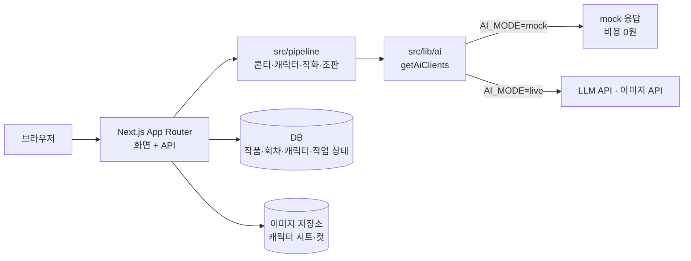

# 아키텍처

## 계층

| 계층          | 위치                  | 책임                                                 |
| ------------- | --------------------- | ---------------------------------------------------- |
| 화면          | `src/app/`            | 7개 화면, 서버 컴포넌트 기본                         |
| API           | `src/app/api/` (예정) | 인증, 입력 검증, 작업 등록·상태 조회                 |
| 파이프라인    | `src/pipeline/`       | UI와 무관한 순수 로직. AI 클라이언트를 인자로 받는다 |
| AI 클라이언트 | `src/lib/ai/`         | mock / live 전환, 비용 기록                          |
| 저장소        | 미정                  | DB와 이미지 저장소 (2주차 결정)                      |

## 화 생성 흐름

1. 사용자가 텍스트를 올리면 API가 입력을 검증하고 **생성 작업**을 등록한다.
2. 콘티를 만든 뒤 `findNewCharacters` 로 새 인물을 찾는다.
   - 있으면 작업 상태를 `awaiting_confirmation` 으로 두고 캐릭터 컨펌 화면으로 보낸다.
   - 없으면 바로 작화로 넘어간다.
3. 컷을 순서대로 생성하며 컷마다 진행 상태를 저장한다(화면은 완성된 컷부터 표시).
4. 조판(말풍선 합성) 후 `completed`.

작업 상태: `queued` → `storyboarding` → `awaiting_confirmation` → `drawing` → `lettering` → `completed` / `failed`

## 열린 질문

- 긴 작업 실행 방식: Vercel 함수 실행 시간 제한 때문에 백그라운드 작업 방식이 필요하다. 후보와 결정은 ADR로 남긴다.
- DB·이미지 저장소 선택
